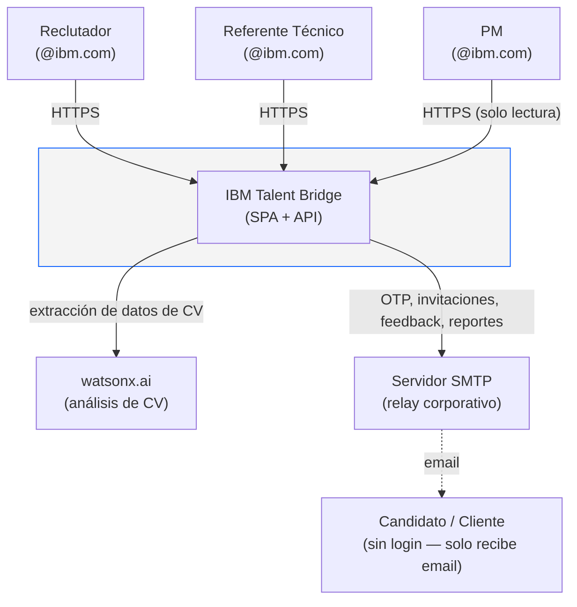
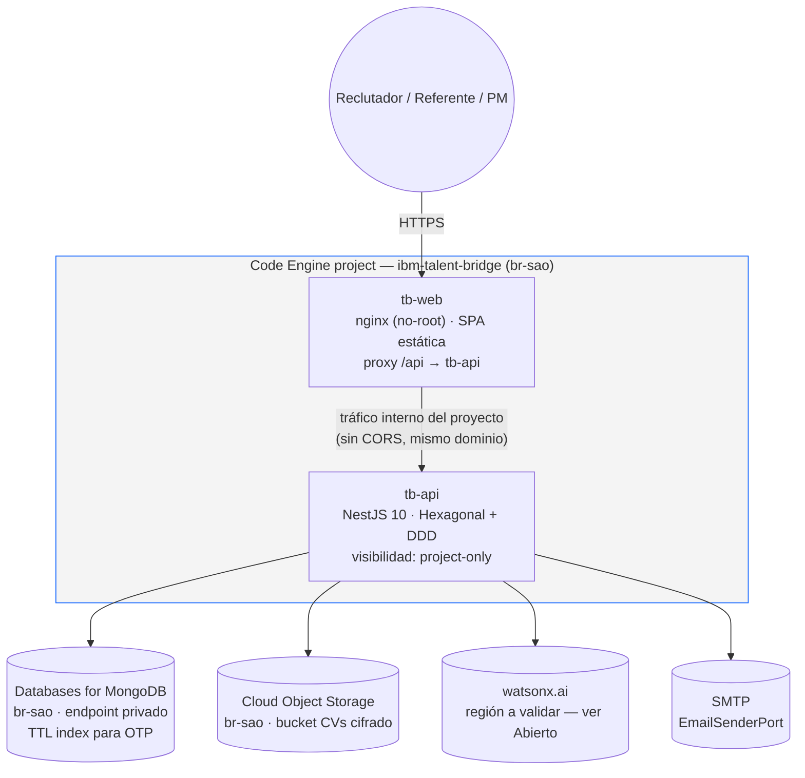
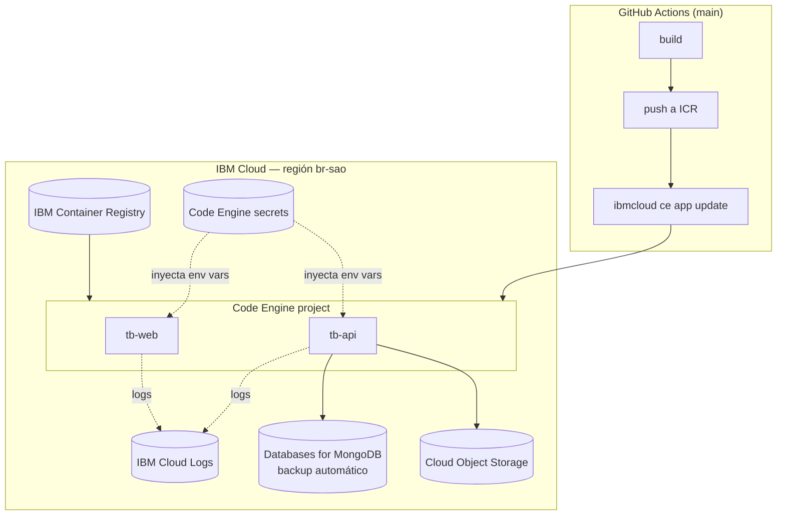

# Arquitectura — IBM Talent Bridge

## Visión General

IBM Talent Bridge sigue una arquitectura de **monorepo con vertical slices**. El backend usa **Arquitectura Hexagonal + DDD**, el frontend usa **Feature Slices**. Despliegue objetivo: **IBM Cloud, un solo ambiente (demo/prod), región `br-sao` (São Paulo), todo en Code Engine**.

> Los diagramas C4 anteriores (`C4/diagram.drawio` + `C4/talent-bridge-ibm.png`) describían otro producto (movilidad interna de empleados, PostgreSQL, .NET) y se archivaron en `docs/archive/c4-otro-producto/` con una nota. Los diagramas Mermaid de abajo son los válidos.

---

## C1 — Diagrama de Contexto



**Notas:**
- El candidato y el cliente **no tienen acceso al sistema**; son destinatarios de correos que el reclutador dispara desde la plataforma (feedback manual, invitaciones a entrevista, reporte final).
- Slack queda fuera del alcance confirmado del MVP salvo que `INT-1` lo retome como fallback de notificación (a decidir en esa iteración, sin servicio nuevo que agregar aquí mientras no se implemente).

---

## C2 — Diagrama de Contenedores



**Notas:**
- `tb-web` es el único punto expuesto; `tb-api` tiene visibilidad `project-only` (no accesible fuera del proyecto Code Engine), por lo que no necesita CORS ni autenticación de red adicional entre los dos.
- Imágenes en **IBM Container Registry (ICR)**, secretos como **secrets de Code Engine**, logs en **IBM Cloud Logs**.

---

## Diagrama de Despliegue



**Notas:**
- Un solo ambiente IBM Cloud (demo/prod); no hay staging separado en el MVP.
- `Secrets Manager` queda como mejora de **Fase 2** — en el MVP los secretos viven directamente como secrets de Code Engine.
- Health checks de Code Engine contra `GET /api/v1/health` en `tb-api`.

---

## Arquitectura del Backend — Capas Hexagonales

```
┌─────────────────────────────────────────────────────────┐
│  INFRASTRUCTURE LAYER                                    │
│  ┌─────────────┐  ┌─────────────────────────────────┐   │
│  │ Controllers │  │ Adapters (DB, HTTP, Storage)      │   │
│  │ (REST API)  │  │ MongoDB / COS / watsonx.ai / SMTP │   │
│  └──────┬──────┘  └──────────────────┬──────────────┘   │
│         │                            │                   │
│  ┌──────▼────────────────────────────▼──────────────┐   │
│  │  APPLICATION LAYER                                │   │
│  │  ┌─────────────┐   ┌──────────────────────────┐  │   │
│  │  │  Use Cases  │   │  Ports (Interfaces)       │  │   │
│  │  │  (Services) │◄──│  Input / Output           │  │   │
│  │  └──────┬──────┘   └──────────────────────────┘  │   │
│  └─────────┼──────────────────────────────────────────┘  │
│            │                                             │
│  ┌─────────▼──────────────────────────────────────────┐  │
│  │  DOMAIN LAYER (Pure TypeScript — zero deps)        │  │
│  │  Entities · Value Objects · DTOs · Interfaces      │  │
│  └────────────────────────────────────────────────────┘  │
└─────────────────────────────────────────────────────────┘
```

## Capabilities (Bounded Contexts)

| Capability | Bounded Context | Responsabilidad |
|-----------|-----------------|-----------------|
| `auth` | Identidad | JWT, dev-login (MVP) / OTP (AUTH-2), roles |
| `candidates` | Talento | CRUD, banco de perfiles, duplicados |
| `processes` | Selección | Wizard, etapas, asignación referentes |
| `interviews` | Agendamiento | Slots, disponibilidad, .ics export |
| `feedback` | Evaluación | Scoring, templates IA, visibilidad |
| `reports` | Reportes | PDF, envío correo, historial |
| `notifications` | Comunicación | Email (`EmailSenderPort` + adapter SMTP) |
| `cv-analysis` | IA | watsonx.ai, upload COS |

---

## Decisiones de Arquitectura (ADRs)

> Las decisiones previas de **Render** (deploy del frontend), **Redis**, **Watson NLU** y **IBM Event Notifications** nunca tuvieron un ADR propio — vivían implícitas en los diagramas de este documento. Quedan **descartadas** y reemplazadas por los ADR-006 a ADR-012 de abajo; no se renumeran los ADRs vigentes (001-005).

### ADR-001: Monorepo con carpetas separadas
- **Decisión:** Monorepo sin herramienta adicional (sin Turborepo/Nx en MVP)
- **Razón:** Simplicidad. Se puede agregar Turborepo en Fase 2 si el build time lo justifica.
- **Alternativas descartadas:** Polyrepo (más overhead de CI/CD), Nx (curva alta para MVP)

### ADR-002: MongoDB como base de datos principal
- **Decisión:** MongoDB flexible sobre PostgreSQL relacional
- **Razón:** Los procesos de selección tienen estructura variable. Los esquemas evolucionan rápido en MVP.
- **Alternativas descartadas:** PostgreSQL (más rígido para esquemas en evolución)

### ADR-003: Arquitectura Hexagonal + Vertical Slice en backend
- **Decisión:** Cada capability es un slice completo (domain/application/infrastructure)
- **Razón:** Cada capability puede extraerse a microservicio en Fase 2 sin tocar otros módulos.
- **Beneficio:** Testabilidad por capa, inversión de dependencias garantizada.

### ADR-004: Candidato identificado por email
- **Decisión:** El email es el campo único de un candidato.
- **Razón:** Evita duplicados y es el identificador natural en procesos de RRHH.

### ADR-005: Templates de correo como HTML plano sin scripts
- **Decisión:** Todos los correos son HTML inline sin `<script>`, `<link>` ni `@import`.
- **Razón:** Compatibilidad con clientes corporativos IBM (Outlook, Notes, webmail).

### ADR-006: Todo en IBM Code Engine (frontend + backend)

- **Contexto:** El frontend estaba planificado en Render (fuera de IBM Cloud); el backend ya apuntaba a Code Engine. Mantener dos proveedores duplica el manejo de secretos, dominios y observabilidad, y Render queda fuera del perímetro IBM que pide el sponsor.
- **Decisión:** Dos apps Code Engine (`tb-web`, `tb-api`) en un solo proyecto. `tb-web` sirve la SPA con nginx y hace proxy de `/api` hacia `tb-api` (visibilidad `project-only`): mismo dominio, sin CORS, API sin exposición pública directa. Requiere `apps/frontend/Dockerfile` de producción (multi-stage: build Vite en `node:22-alpine`, runtime `nginx-unprivileged`).
- **Consecuencias:** Se descarta Render. Un solo proveedor, un solo set de secretos y logs. El build del frontend necesita contexto de repo raíz (`docker build -f apps/frontend/Dockerfile .`) porque importa `packages/shared-types` por alias.

### ADR-007: Región única `br-sao` (São Paulo)

- **Contexto:** Latencia y residencia de datos para un cliente LatAm; evitar fragmentar servicios entre regiones sin necesidad.
- **Decisión:** Databases for MongoDB, Cloud Object Storage, Code Engine e IBM Container Registry viven en `br-sao`.
- **Consecuencias:** **watsonx.ai probablemente no está disponible en `br-sao`** (ver sección "Abierto" abajo) — hay que verificarlo antes de implementar `CV-1`. Si no está disponible, el texto del CV se envía de forma transitoria a la región más cercana que sí lo tenga, **sin email ni teléfono** (enmascarados antes de enviar) y sin persistir nada fuera de `br-sao`. Requiere validación de sponsor y compliance antes de comprometerse.

### ADR-008: Sin Redis en el MVP

- **Contexto:** Redis estaba planificado (sesiones, cache de disponibilidad, OTP) pero ningún código lo usa; es un servicio con costo y operación propios que no se justifica para una sola instancia en el MVP.
- **Decisión:** Los OTP (`AUTH-2`) se guardan **hasheados en MongoDB con índice TTL** (expiran solos, sin job de limpieza). El rate limiting usa el throttler en memoria de NestJS (`@nestjs/throttler`, ya configurado en `app.module.ts`).
- **Consecuencias:** Válido mientras `tb-api` corra como una sola instancia. Si se escala horizontalmente, el throttler en memoria deja de ser consistente entre instancias y se necesita un store compartido (Redis u otro) — se revisita en ese momento, no antes. Se elimina Redis de `docker-compose*.yml`, `.env.example`, la dependencia `ioredis` de `apps/backend/package.json`, y toda mención en la documentación.

### ADR-009: watsonx.ai para análisis de CV (reemplaza Watson NLU)

- **Contexto:** Watson NLU nunca fue un parser de CV (es análisis de sentimiento/entidades de texto genérico); watsonx.ai (modelos generativos) es la herramienta correcta para extraer datos estructurados de un CV no estructurado, y es la pieza central de la demo con el sponsor del watsonx Challenge.
- **Decisión:** `cv-analysis` expone un `CvAnalysisPort` detrás del cual se implementa un adapter para watsonx.ai (prompt + modelo configurable). Reemplaza toda mención a Watson NLU en `PROJECT_CONTEXT.md`, `ROADMAP.md` (`CV-1`), `.env.example` (`WATSONX_URL`, `WATSONX_PROJECT_ID`, `WATSONX_API_KEY`, `WATSONX_MODEL_ID`) y en el paso 3 del wizard ("Sugerir skills desde el CV").
- **Consecuencias:** El servicio nunca conoce el proveedor (watsonx.ai) directamente, solo el puerto — si watsonx.ai no está disponible en `br-sao`, cambiar el adapter o la región de la llamada no toca `cv-analysis` por fuera de `infrastructure/adapters/`. Opcionalmente reutilizable en `REP-1` para un borrador de reporte al cliente.

### ADR-010: Email detrás de un `EmailSenderPort` con adapter SMTP (reemplaza Event Notifications)

- **Contexto:** IBM Event Notifications no es un servicio de envío de correo (es un bus de eventos/alertas); nunca encajó con "enviar OTP e invitaciones por email".
- **Decisión:** `notifications` expone `EmailSenderPort` con un adapter SMTP (`SMTP_HOST`, `SMTP_PORT`, `SMTP_USER`, `SMTP_PASS`, `SMTP_FROM`). Se quita Event Notifications de toda la documentación y de `.env.example`.
- **Consecuencias:** Actualiza el alcance de `AUTH-2` (envío de OTP) e `INT-1` (notificación al referente). Deliverability del relay SMTP corporativo queda pendiente de validar (ver "Abierto").

### ADR-011: Secretos de Code Engine + CI/CD por GitHub Actions

- **Contexto:** No había nada definido sobre registro de imágenes, manejo de secretos ni pipeline de deploy hacia IBM Cloud.
- **Decisión:**
  - Imágenes en **IBM Container Registry (ICR)**.
  - Secretos como **secrets de Code Engine** (Secrets Manager queda para Fase 2).
  - `backend-ci.yml` / `frontend-ci.yml` agregan un job de deploy que corre **solo en `main`**: build → push a ICR → `ibmcloud ce app update`, autenticado con un API key de IBM Cloud guardado como secret de GitHub.
  - Health checks de Code Engine contra `GET /api/v1/health`.
  - Logs centralizados en **IBM Cloud Logs**.
  - Backup automático de Databases for MongoDB (función nativa del servicio).
  - Política de retención de CVs en COS — **a definir** (no bloqueante para el MVP, se revisita en `DEPLOY-1`).
- **Consecuencias:** `DEPLOY-1` queda con alcance concreto (ver `ROADMAP.md`) en vez de "pendiente de decisión".

### ADR-012: Autenticación — dev-login → OTP, SSO en Fase 2

- **Contexto:** `AUTH-1` (dev-login con usuarios sembrados) existe para no bloquear la demo con un flujo OTP completo. SSO corporativo (w3id) requiere onboarding interno, y IBM App ID está en camino de reemplazo por **IBM Security Verify**.
- **Decisión:** MVP = `AUTH-1` (dev-login, deshabilitado si `NODE_ENV=production`) seguido de `AUTH-2` (OTP real por correo, Mongo TTL + `EmailSenderPort`, ver ADR-008 y ADR-010). SSO w3id queda para Fase 2, sin comprometerse todavía a App ID ni a su sucesor.
- **Consecuencias:** Cualquier mención futura a "IBM App ID" en código o docs debe leerse como "Fase 2, pendiente de verificar si sigue siendo App ID o pasa a IBM Security Verify" — no implementar wiring real contra App ID hasta esa verificación.

---

## Abierto — validar con sponsor/compliance

- **Disponibilidad de watsonx.ai en `br-sao`**, y si no está disponible, si el envío transitorio del texto del CV (sin email/teléfono, enmascarados) a otra región es aceptable para compliance. Mismo chequeo para Databases for MongoDB y Code Engine en `br-sao` (se asumen disponibles, pero no verificado contra la consola real).
- **Cuenta de IBM Cloud:** quién es el owner y quién paga — una cuenta interna de IBM Consulting o una cuenta de la iniciativa/challenge.
- **Relay SMTP corporativo:** disponibilidad real y si los correos a `@ibm.com` y a dominios de clientes externos llegan sin marcarse como spam (sin esto, OTP e invitaciones no son confiables).
- **Exposición de la app:** internet público vs. detrás de la VPN de IBM, y si lleva dominio propio (afecta `tb-web` y el certificado TLS).
- **SSO:** si w3id/IBM Security Verify se habilita en Fase 2 requiere onboarding interno — no asumir que es "solo configuración" hasta confirmarlo con el equipo de identidad de IBM.
